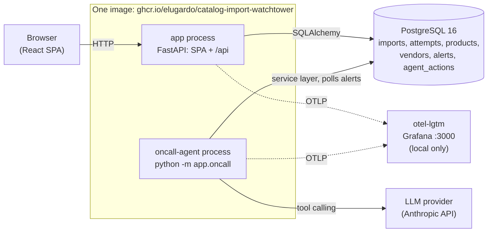

# Catalog Import Watchtower

[](https://github.com/elugardo/catalog-import-watchtower/actions/workflows/ci.yml)

Catalog Import Watchtower (CIW) imports vendor product catalogs from CSV
files. It checks every row before it writes anything, then upserts the
products in one transaction, and it keeps a history of every import and
each attempt. When an import fails, CIW raises a durable user-impact alert.
A separate on-call worker, driven by a real LLM with tool calling, picks up
the alert, retries a transient failure once, escalates everything else, and
leaves an audit trail.

It is the final project for the AI Dev Tools Zoomcamp 2026. The course work
lives in [`elugardo/ai-dev-tools-zoomcamp`](https://github.com/elugardo/ai-dev-tools-zoomcamp).
The specification is [`_docs/spec.md`](_docs/spec.md), and the agent team
built the project from it through public GitHub issues (see
[AI-assisted workflow](#ai-assisted-workflow)).

**State at this commit (2026-10-26).** Everything the rubric asks for is on
`main`:
- the app and the tests
- the on-call agent with a recorded real-LLM recovery (#11)
- OpenTelemetry (#12)
- the Grafana dashboard and alert rule with their walkthrough (#13)
- CI/CD with dev and prod deployments, promotion and rollback (#14, #15)

#13 is merged, and its QA verdict is pending. #44 is parked. The
[Rubric evidence](#rubric-evidence) table gives the status of each row.

## Problem

A store that sells products from many vendors gets their catalogs as CSV
files. Imports fail in two ways. The data is wrong (a negative quantity, a
bad price, a duplicate SKU), or something technical breaks halfway (the
database times out). In both cases the operator who oversees the imports
needs answers to three questions. What happened? Did the catalog change, and
if so how much of it? What should happen next?

A naive importer writes the good rows and skips the bad ones. That leaves
the catalog half-updated, and nobody can tell which half. It also gives no
history to look back at and no signal when something breaks.

The user is one operations or admin person who watches imports for several
demo vendors. There is no login in this MVP, and all data is synthetic.

## What it does

- **Upload** a CSV for a vendor (by name) on the Upload page or with
  `POST /api/imports`. The file is at most 256 KiB, is UTF-8, and has the
  header `sku,name,price,quantity`.
- **Whole-file validation.** Every row is checked before anything is
  written. If one row is invalid, the import fails with `VALIDATION_ERROR`
  and errors per row and column (for example
  `line 4, quantity: must be a whole number of up to 9 digits, got '-2'`).
  **No product changes.**
- **All-or-nothing upsert.** A valid file is written in one database
  transaction, as an upsert keyed on `(vendor_id, normalized_sku)`. Rows in
  the file are created or updated. SKUs missing from a later file stay as
  they were (this is not a full replacement). Prices are integer cents, and
  timestamps are UTC.
- **History and attempts.** Every import keeps its file hash, row and
  product counts, and its attempts (attempt number, status, error code,
  trace id, timings). The UI has a Dashboard, Imports, Import detail and
  Products (filtered by vendor, with Load more).
- **User-impact alert.** An import that ends `FAILED` writes one durable
  `alerts` row in the same transaction. The Dashboard lists it under *Open
  incidents* and the import detail page shows it.
- **On-call agent.** A separate worker process polls for `OPEN` alerts. It
  investigates through six allowlisted tools and retries only a transient
  storage timeout, at most once. Every other alert is marked
  `NEEDS_ATTENTION`. Each tool call and decision is stored and shown as a
  timeline on the import detail page (see [On-call agent](#on-call-agent)).
- **Statuses.** An import is `PROCESSING`, `COMPLETED` or `FAILED`.
  **Recovered** is only a UI label, not a status: it marks a `COMPLETED`
  import that took more than one attempt.

## Architecture



- **One image runs two processes.** `app` serves the built SPA and the API
  from one origin. `oncall-agent` is the same image started as
  `python -m app.oncall`, and it calls the service layer directly. There are
  no internal HTTP endpoints and no internal token. Only the worker talks to
  the LLM, and only the worker gets the API key.
- **Locally**, `compose.yaml` runs `app`, `oncall-agent`, `db` (PostgreSQL)
  and `otel-lgtm` (Grafana with Loki, Tempo and Prometheus).
- **Deployed** (ADR-0002, [`_docs/adr/0002-deployment-provider.md`](_docs/adr/0002-deployment-provider.md)):
  the image is published to GHCR. Two Fly.io apps run it, `ciw-dev` and
  `ciw-prod`, each with only the `app` process (zero worker machines,
  `AGENT_ENABLED=false`) and its own Neon PostgreSQL project. Telemetry is
  not exported from deployed environments.

```
GitHub (PR) --ci.yml--> tests, gitleaks, image build, compose smoke
main push --deploy-dev.yml--> GHCR sha-<commit> + dev --flyctl deploy --image--> ciw-dev (Neon dev)
manual    --promote-prod.yml (production approval)-------> same sha-<commit> --> ciw-prod (Neon prod)
```

More detail is in [`_docs/architecture.md`](_docs/architecture.md), and the
API is in [`_docs/api.md`](_docs/api.md) and [`openapi.yaml`](openapi.yaml).

## Quick start

You need Docker with Compose v2. No `.env` file is needed.

```
docker compose up --build
```

| What | URL |
|---|---|
| App (SPA + API) | http://localhost:8000 |
| Health | http://localhost:8000/api/health |
| Grafana (otel-lgtm) | http://localhost:3000 |

Then upload `fixtures/valid.csv`, `fixtures/update.csv` and
`fixtures/invalid.csv` from the Upload page. To simulate a failure, tick
**Demo: fail first attempt with transient storage timeout**.
`docker compose down -v` stops the stack and drops the data volume.

**Configuration.** Every variable is listed in [`.env.example`](.env.example)
with a safe placeholder, and [`_docs/operations.md`](_docs/operations.md) ->
*Configuration* explains each one.

**The app works without an LLM key.** By default `AGENT_ENABLED=false`, so
the worker logs one idle line and claims nothing. A failed import's alert
stays `OPEN`, and the UI shows **automated recovery disabled**.

**To enable the real LLM (optional, local only).** Copy `.env.example` to
`.env`, which git ignores and which is never committed. Then set:

- `AGENT_ENABLED=true`
- `LLM_PROVIDER=anthropic`
- `LLM_MODEL=<model name>`, for example `claude-haiku-5-5`
- `ANTHROPIC_API_KEY=<your key>`, in `.env` only

Then run `docker compose up --build` again. Compose passes the key to
`oncall-agent` only. The exact steps are in [`_docs/operations.md`](_docs/operations.md)
-> *The real-LLM demonstration*.

## Tests

This is the one test command. It needs only Docker:

```
docker compose -f compose.yaml -f compose.test.yaml run --rm --build test
```

It runs every layer in order and prints one summary line for each:

- **backend unit tests**, with no database
- **integration tests** against a real PostgreSQL, migrated by Alembic, on
  its own `<db>_suite` database, so your data is never touched
- **the contract check** (`check:api`: the generated TypeScript client must
  match `openapi.yaml`)
- **the frontend tests** (Vitest + Testing Library)

The on-call worker's tests use a fake LLM and never call a provider. CI runs
the same command on every pull request.

- A green CI run on `main` (dispatched by hand on `2e39af2`, all four
  jobs):
  [run 40332945673](https://github.com/elugardo/catalog-import-watchtower/actions/runs/40332945673)
- A green CI run of the last PR merged into `main` (#59, all four jobs):
  [run 40326156089](https://github.com/elugardo/catalog-import-watchtower/actions/runs/40326156089)
- Measured counts and times: [`_docs/evidence/2026-10-25-tests/report.md`](_docs/evidence/2026-10-25-tests/report.md)
  and [`_docs/testing.md`](_docs/testing.md).

## Deployment and CI/CD

| Workflow | Trigger | What it does |
|---|---|---|
| [`ci.yml`](.github/workflows/ci.yml) | every pull request (and by hand) | gitleaks secret scan over the full history; the one test command; one runtime image build; scenario 6 (`docker compose up --wait`, then `/api/health`) |
| [`deploy-dev.yml`](.github/workflows/deploy-dev.yml) | every push to `main` | builds the image once and pushes `sha-<commit>` and `dev` to GHCR; runs `flyctl deploy --image` to `ciw-dev` (Fly's `release_command` runs `alembic upgrade head`); keeps zero worker machines; smoke-checks `/api/health` for that version |
| [`promote-prod.yml`](.github/workflows/promote-prod.yml) | manual (`workflow_dispatch`, input `tag`) | checks that the tag is `sha-<40 hex>`, exists in GHCR and was deployed by dev, before it asks for anything; waits for the `production` environment approval; deploys that **exact image, no rebuild**, to `ciw-prod`; runs the smoke check |

| Environment | URL | Health |
|---|---|---|
| Development | <https://ciw-dev.fly.dev> | [`/api/health`](https://ciw-dev.fly.dev/api/health) |
| Production | <https://ciw-prod.fly.dev> | [`/api/health`](https://ciw-prod.fly.dev/api/health) |

Both URLs answered `200` when this README was checked (the response is in
the PR of #16). Deployed apps stop when idle, so the first request can take
a few seconds while the machine wakes up.

- **Promotion** means promoting the exact `sha-<commit>` tag that dev ran:
  `gh workflow run promote-prod.yml -f tag=sha-<full SHA>`, followed by an
  approval in the `production` environment.
- **Rollback** is a promotion of the previous tag, through the same
  workflow, validation, approval and smoke check. Migrations are additive
  only, and a rollback runs no down-migration. See
  [`_docs/operations.md` -> *Rollback*](_docs/operations.md#rollback-issue-10).
- **Recorded runs.**
  - PR CI: [40267315673](https://github.com/elugardo/catalog-import-watchtower/actions/runs/40267315673)
    (green), plus the deliberately red gitleaks run
    [40267327422](https://github.com/elugardo/catalog-import-watchtower/actions/runs/40267327422).
  - Dev deploys: [40276218575](https://github.com/elugardo/catalog-import-watchtower/actions/runs/40276218575)
    and [40320919888](https://github.com/elugardo/catalog-import-watchtower/actions/runs/40320919888).
  - Promotion of N: [40321537500](https://github.com/elugardo/catalog-import-watchtower/actions/runs/40321537500).
  - Rollback to N-1: [40323819935](https://github.com/elugardo/catalog-import-watchtower/actions/runs/40323819935).
  - Forward to N: [40324903367](https://github.com/elugardo/catalog-import-watchtower/actions/runs/40324903367).
  - Refused tags (failed before any approval was requested):
    [40321348121](https://github.com/elugardo/catalog-import-watchtower/actions/runs/40321348121),
    [40321353027](https://github.com/elugardo/catalog-import-watchtower/actions/runs/40321353027),
    [40321357399](https://github.com/elugardo/catalog-import-watchtower/actions/runs/40321357399).
- **Evidence.** [`_docs/evidence/2026-10-26-deploy-dev/report.md`](_docs/evidence/2026-10-26-deploy-dev/report.md)
  (#14) and [`_docs/evidence/2026-10-26-deploy-prod/report.md`](_docs/evidence/2026-10-26-deploy-prod/report.md)
  (#15).
- **Prod screenshots** are in the prod report:
  [health](_docs/evidence/2026-10-26-deploy-prod/04-prod-health.png),
  [dashboard](_docs/evidence/2026-10-26-deploy-prod/03-prod-dashboard.png),
  the three approved runs ([N](_docs/evidence/2026-10-26-deploy-prod/01-promote-N-approved-green.png),
  [N-1](_docs/evidence/2026-10-26-deploy-prod/02a-rollback-N-1-approved-green.png),
  [N again](_docs/evidence/2026-10-26-deploy-prod/02b-forward-N-approved-green.png)),
  and a run [held at the `production` gate](_docs/evidence/2026-10-26-deploy-prod/06a-promote-pending-gate.png)
  and then [approved](_docs/evidence/2026-10-26-deploy-prod/06b-promote-approved-after-pending.png).
- **Not done.** Branch protection with required checks on `main` is not
  set. The deploy-dev report records this.

## Observability

Both processes export OpenTelemetry traces, structured logs and metrics
over OTLP to the local `otel-lgtm` container (Collector, Tempo, Loki,
Prometheus, Grafana), which is provisioned from [`observability/`](observability/).
A failed import can be followed by **one `trace_id`**. It appears on the
attempt row, on the attempt's spans and on its log lines. Metric labels are
low-cardinality only (`outcome`, `error_category`), and no catalog content
goes into telemetry.

**It is on by default in the local stack.** `compose.yaml` sets
`OTEL_SDK_DISABLED=false` for `app` and `oncall-agent`. Telemetry is off in
the test overlay and on Fly. Run `docker compose up --build`, then open
Grafana at http://localhost:3000, with anonymous access and no login.

**Reviewer path** ([`_docs/operations.md` -> *Telemetry* -> *Reviewer path*](_docs/operations.md#telemetry-issue-09-instrumentation-in-ciw-091-12-grafana-in-ciw-092-13)):

1. Upload `fixtures/valid.csv` with the Demo box ticked.
2. Copy the failed attempt's trace id from the import detail page.
3. In Grafana -> *Explore* -> *Tempo*, paste the trace id. The trace shows
   `POST /api/imports` -> `catalog.import.attempt` -> `catalog.import.validate`,
   then `catalog.import.upsert` in error.
4. Use *Logs for this span* to open the attempt's Loki lines for the same
   `trace_id`.
5. The *Catalog Import Watchtower* dashboard shows the new `FAILED` step,
   *Open alerts* rising by one, and the row in *Recent failed attempts*.

**User-impact alert, in two layers**
([`_docs/operations.md` -> *Alerting*](_docs/operations.md#alerting-issue-05-09)):

- **The durable `alerts` row.** It is written when an import ends `FAILED`,
  shown on the Dashboard and the import detail page, and it is what wakes
  the on-call worker.
- **The Grafana alert rule *Catalog import failed*.** It is provisioned on
  `catalog_import_alerts_open > 0`. It fires on a failed import, returns to
  Normal after recovery, and has no contact point.

**Evidence.**
[`_docs/evidence/2026-10-26-observability/report.md`](_docs/evidence/2026-10-26-observability/report.md)
(#13; its QA verdict is pending) contains:
- [Tempo trace](_docs/evidence/2026-10-26-observability/01-tempo-failed-attempt-trace.png)
- [Loki logs for that trace](_docs/evidence/2026-10-26-observability/02-loki-logs-for-trace.png)
- [dashboard](_docs/evidence/2026-10-26-observability/03-dashboard.png)
- [rule firing](_docs/evidence/2026-10-26-observability/04a-rule-firing-runA.png)
- [rule back to Normal](_docs/evidence/2026-10-26-observability/04b-rule-normal-runB.png)

In that run the recovery was done by hand through the tools CLI, so there
is no agent-run trace in it. The UI half of the alert is in
[`_docs/evidence/2026-10-25-user-impact-alert/report.md`](_docs/evidence/2026-10-25-user-impact-alert/report.md).

## On-call agent

The on-call agent is a **real LLM with tool calling** (Anthropic, through
the official SDK). It runs as its own process, `oncall-agent`. Every
`AGENT_POLL_SECONDS` (default 10 s) it claims the oldest `OPEN` alert and
runs one bounded conversation: at most 8 tool calls and 120 s. The model
can use only six allowlisted tools, and each tool guards itself in code:

| Tool | Does |
|---|---|
| `get_import_incident(alert_id)` | the redacted incident (no catalog content) |
| `get_import_attempts(import_id)` | attempts with status, error code, trace id, timings |
| `get_import_diagnostics(import_id)` | observability query strings and counts |
| `retry_failed_import(import_id)` | reprocesses the saved CSV as attempt 2; refused unless `FAILED` + `TRANSIENT_STORAGE_TIMEOUT` + one attempt |
| `mark_needs_attention(alert_id, reason)` | escalates with a short, content-free reason |
| `resolve_alert(alert_id)` | resolves only when the import is `COMPLETED` |

**Policy.** The agent retries only `TRANSIENT_STORAGE_TIMEOUT`, and at most
once (two attempts in total). On success it resolves the alert. Everything
else, including `VALIDATION_ERROR`, a second timeout and any unknown code,
is marked `NEEDS_ATTENTION` with no retry. Every tool call, the decision and
the run start and finish are stored in `agent_actions` and shown as a
timeline on the import detail page. No CSV rows, vendor names or product
names are sent to the LLM.

- **In CI and tests**, a fake LLM client (`tests/oncall/`) checks the policy
  and also checks models that misbehave. No test calls a provider.
- **Deployed**, `AGENT_ENABLED=false` and there are no worker machines, so
  alerts stay `OPEN` with **automated recovery disabled**. The real-LLM run
  is local only.
- **Evidence: one real-LLM recovery**, in
  [`_docs/evidence/2026-10-26-real-llm-recovery/`](_docs/evidence/2026-10-26-real-llm-recovery/report.md).
  `claude-haiku-5-5` called `get_import_incident` -> `retry_failed_import`
  (attempt 2 `SUCCEEDED`) -> `resolve_alert`. The import ended `COMPLETED`
  and *Recovered*, and the folder holds the timeline screenshot and the
  `agent_actions` export. #11 is closed.
- That run had telemetry off, because it came before #12. The
  observability walkthrough (#13) did its recovery by hand through the
  tools CLI. So no screenshot shows an agent-run trace.
- The role and the six-tool contract are in [`_docs/team/oncall-agent.md`](_docs/team/oncall-agent.md).
  The same routine for a person doing triage by hand is in
  [`.agents/skills/incident-response/SKILL.md`](.agents/skills/incident-response/SKILL.md).

## AI-assisted workflow

The project was built by a team of AI agents, Claude Code subagents, from
the spec and public GitHub issues. Marcos wrote and signed off the spec
(v1.1, 2026-10-24), chose deadline mode, and reviews the record afterwards.

**Roles** (each is defined in [`_docs/team/`](_docs/team/) and [`.claude/agents/`](.claude/agents/)):

- **Product manager.** Turns the spec into issues with acceptance criteria,
  grooms each issue before work starts, and approves or requests changes
  after QA. Writes no code.
- **Software engineer.** Implements exactly one groomed issue on its
  branch, with tests and doc updates, opens the PR, and writes a hand-off
  comment. Never closes the issue.
- **QA engineer.** Always starts in a fresh context. Checks the acceptance
  criteria by running the code, fixes nothing, and ends with `PASS` or
  `FAIL`.
- **Orchestrator.** The main session, which runs
  [`.claude/skills/work-issue/SKILL.md`](.claude/skills/work-issue/SKILL.md).
  It starts each role, merges, and closes the issue with an evidence
  comment.
- **Runtime on-call agent.** This one is part of the product, not the
  development team. It is the LLM worker described above, limited to six
  tools.

**Delegation.** Each issue goes through one cycle: groom -> implement ->
independent QA -> PM approval -> merge on green CI -> close with evidence
([`_docs/process.md`](_docs/process.md)). The context each role gets
(`AGENTS.md`, its role file, the issue, and the docs that `AGENTS.md` ->
*Read this first* names) is in
[`report.md` -> *Context per role*](_docs/evidence/2026-10-25-agent-workflow/report.md#context-per-role).

**The gate.** A PR is merged only after an independent QA `PASS`, then the
PM's `APPROVED`, then green CI. Marcos is not a merge gate. On 2026-10-25
he chose **deadline mode** ([`_docs/process.md` -> *Deadline mode*](_docs/process.md#deadline-mode-from-2026-10-25)):
CI is the full test run, two tracks run in parallel, roles are time-boxed,
and #44 is parked. From 2026-10-26, at Marcos's request, a PR is merged as
soon as its CI is green after the hand-off. QA and PM approval then run on
the merged code, a FAIL or CHANGES REQUESTED is fixed forward in a new PR,
and the issue closes only after both verdicts are recorded. #11 was the
first issue under this rule.

**How outputs were checked.**

- **#8, QA FAIL -> fix -> PASS.** The engineer reported everything green.
  QA then seeded an in-flight import and found that the suite rewrote it:
  [FAIL](https://github.com/elugardo/catalog-import-watchtower/issues/8#issuecomment-6401056586),
  [engineer fix](https://github.com/elugardo/catalog-import-watchtower/issues/8#issuecomment-6401198212),
  [re-test PASS](https://github.com/elugardo/catalog-import-watchtower/issues/8#issuecomment-6401353707).
- **#9, CHANGES REQUESTED.** The PM sent a QA-passed issue back:
  [CHANGES REQUESTED](https://github.com/elugardo/catalog-import-watchtower/issues/9#issuecomment-6402551325),
  [fix](https://github.com/elugardo/catalog-import-watchtower/issues/9#issuecomment-6402657579),
  [QA PASS](https://github.com/elugardo/catalog-import-watchtower/issues/9#issuecomment-6402726439),
  [APPROVED](https://github.com/elugardo/catalog-import-watchtower/issues/9#issuecomment-6402798985).
- **Full cycles to read** (groom, hand-off, QA, PM and PR comments on one
  page): [#7](https://github.com/elugardo/catalog-import-watchtower/issues/7),
  [#8](https://github.com/elugardo/catalog-import-watchtower/issues/8),
  [#10](https://github.com/elugardo/catalog-import-watchtower/issues/10).
  Every cycle is linked in
  [`report.md` -> *Cycles*](_docs/evidence/2026-10-25-agent-workflow/report.md#cycles).

**Deviations from the process**, stated openly:

- The ones recorded in
  [`report.md` -> *Deviations*](_docs/evidence/2026-10-25-agent-workflow/report.md#deviations).
  Examples: #8 was closed early by a closing keyword in its PR, and three
  commits went straight to `main`.
- The tool's safety classifier blocked the engineer agent from provisioning
  Fly.io and Neon. The orchestrator did the provisioning instead, with
  Marcos's approval.
- The three production approvals were given through the GitHub API under
  Marcos's account, on his written instruction. The `production`
  environment gate itself stayed active
  ([deploy-prod report](_docs/evidence/2026-10-26-deploy-prod/report.md)).
- Two tracks ran in parallel worktrees. One worktree agent's tools wrote
  into the other track's checkout. This was caught and corrected.
- The engineer's tooling on #12 refused to write the smoke-report `.md`.
  The orchestrator committed that report from the engineer's text.
- A follow-up issue that QA tried to open with `gh issue create` was denied
  by the tool permissions. The PM folded the finding into the open issue
  instead.
- #15 failed QA twice because screenshots were missing. It passed once they
  were added
  ([#15's comments](https://github.com/elugardo/catalog-import-watchtower/issues/15)).

## Limitations and non-goals

- **Non-goals** (spec §3): authentication and roles, multi-tenancy, supplier
  APIs and webhooks, a column-mapping UI, Excel files, scheduled pulls,
  inventory or order integration, price history, approval workflows,
  notifications, a job queue, AI changes to catalog data, large files, a
  manual retry button (the operator uploads a corrected file instead),
  acknowledging or dismissing alerts, and pagination outside Products.
- **No authentication.** Anyone who can reach a URL can upload. Deployed
  environments hold only synthetic fixture data.
- **The failure injector is synthetic.** The checkbox **Demo: fail first
  attempt with transient storage timeout** makes attempt 1 fail on purpose.
  It is not a real outage. A real database `OperationalError` maps to the
  same `TRANSIENT_STORAGE_TIMEOUT` code.
- **The agent is disabled in deployed environments.** The real-LLM run is
  local only, with Marcos's own key. CI uses a fake LLM.
- **Telemetry is local only.** Nothing is exported from deployed
  environments. Fly sets `OTEL_SDK_DISABLED=true`.
- **Parked:** #44 (declaring the 500 `INTERNAL_ERROR` in `openapi.yaml`)
  was parked by deadline mode.
- **Branch protection** with required checks on `main` is not set.

## Rubric evidence

The 12 rows follow [`_docs/rubric.md`](_docs/rubric.md). A row is `done` only
when every artefact it names is on `main`.

| # | Criterion | Status | Evidence |
|---|---|---|---|
| 1 | Problem description | done | this README: [Problem](#problem), [What it does](#what-it-does), [Demo](#demo) |
| 2 | Product specification | done | [`_docs/spec.md`](_docs/spec.md); [issues labelled `final-project`](https://github.com/elugardo/catalog-import-watchtower/issues?q=label%3Afinal-project); [`_docs/backlog.md`](_docs/backlog.md); [agent-workflow report](_docs/evidence/2026-10-25-agent-workflow/report.md) |
| 3 | Agent team specification | done | [`_docs/team/`](_docs/team/), [`_docs/process.md`](_docs/process.md), [`.claude/agents/`](.claude/agents/), [`work-issue` skill](.claude/skills/work-issue/SKILL.md); [report -> *Roles and process*](_docs/evidence/2026-10-25-agent-workflow/report.md#roles-and-process) |
| 4 | Context management | done | [`AGENTS.md`](AGENTS.md) -> modular [`_docs/`](_docs/); [report -> *Context per role*](_docs/evidence/2026-10-25-agent-workflow/report.md#context-per-role) |
| 5 | Application | done | [`compose.yaml`](compose.yaml); [Quick start](#quick-start); [products after restart](_docs/evidence/2026-10-25-ui-detail-products/products-after-restart.jpg) |
| 6 | Testing | done | [Tests](#tests) (the one command); [CI run on `main` 40332945673](https://github.com/elugardo/catalog-import-watchtower/actions/runs/40332945673), [PR run 40326156089](https://github.com/elugardo/catalog-import-watchtower/actions/runs/40326156089); [test report](_docs/evidence/2026-10-25-tests/report.md) |
| 7 | Containerization | done | [`compose.yaml`](compose.yaml), [`Dockerfile`](Dockerfile), [`compose.test.yaml`](compose.test.yaml), [`Dockerfile.test`](Dockerfile.test) |
| 8 | Deployment | done | dev and prod are live ([Deployment](#deployment-and-cicd)); [ADR-0002](_docs/adr/0002-deployment-provider.md); [dev report](_docs/evidence/2026-10-26-deploy-dev/report.md) with a [dev health screenshot](_docs/evidence/2026-10-26-deploy-dev/05-api-health.jpg); [prod report](_docs/evidence/2026-10-26-deploy-prod/report.md) with a [prod health screenshot](_docs/evidence/2026-10-26-deploy-prod/04-prod-health.png) and the [prod dashboard](_docs/evidence/2026-10-26-deploy-prod/03-prod-dashboard.png) |
| 9 | CI/CD | done | [`.github/workflows/`](.github/workflows/); PR run [40267315673](https://github.com/elugardo/catalog-import-watchtower/actions/runs/40267315673), dev deploy [40320919888](https://github.com/elugardo/catalog-import-watchtower/actions/runs/40320919888), promotion [40321537500](https://github.com/elugardo/catalog-import-watchtower/actions/runs/40321537500), rollback [40323819935](https://github.com/elugardo/catalog-import-watchtower/actions/runs/40323819935); [*Rollback*](_docs/operations.md#rollback-issue-10); [dev](_docs/evidence/2026-10-26-deploy-dev/report.md) and [prod](_docs/evidence/2026-10-26-deploy-prod/report.md) reports |
| 10 | Observability | done (#13 QA pending) | [`observability/`](observability/); [walkthrough](_docs/evidence/2026-10-26-observability/report.md) with the [Tempo trace](_docs/evidence/2026-10-26-observability/01-tempo-failed-attempt-trace.png), the [Loki logs for the same `trace_id`](_docs/evidence/2026-10-26-observability/02-loki-logs-for-trace.png) and the [dashboard](_docs/evidence/2026-10-26-observability/03-dashboard.png); query cheat-sheet in [`operations.md` -> *Telemetry*](_docs/operations.md#telemetry-issue-09-instrumentation-in-ciw-091-12-grafana-in-ciw-092-13) |
| 11 | Alerting on user impact | done (#13 QA pending) | the durable alert in the UI ([report](_docs/evidence/2026-10-25-user-impact-alert/report.md), [screenshot](_docs/evidence/2026-10-25-user-impact-alert/dashboard-open-incidents.jpg)); the provisioned rule [`ciw-alert-rules.yaml`](observability/grafana/provisioning/alerting/ciw-alert-rules.yaml), shown [firing](_docs/evidence/2026-10-26-observability/04a-rule-firing-runA.png) and [back to Normal](_docs/evidence/2026-10-26-observability/04b-rule-normal-runB.png) |
| 12 | On-call agent | done | [`app/oncall/`](app/oncall/); [real-LLM recovery](_docs/evidence/2026-10-26-real-llm-recovery/report.md) with [two attempts and the timeline](_docs/evidence/2026-10-26-real-llm-recovery/import-detail-attempts-and-timeline.jpg) |

## Demo

This is a scripted walkthrough of the six steps of the spec §14
*Recommended 3-minute demo script*. Each step says what to do, what you
should see, and which existing screenshot shows it. An agent cannot record
video, so this script and the screenshots take its place. If Marcos records
a video (3 minutes at most), it is linked here as well. No video exists
yet. The screenshots are reused from the evidence folders of the issues
that produced them, and the only catalog data in them is the committed
synthetic fixtures.

**Setup:** `docker compose down -v`, then `docker compose up --build -d --wait`,
then open http://localhost:8000/. With no `.env`, the agent is off. Step 5
needs the optional real-LLM setup from [Quick start](#quick-start). Without
it, the alert stays `OPEN` with **automated recovery disabled**, and the
recorded real-LLM run shows the rest.

**1. Open the dashboard: prior imports and product counts.**

- **Do:** open the dashboard. On a fresh volume it is empty. To see
  history, upload the fixtures once (steps 2 and 3) and come back.
- **See:** the Completed, Recovered and Failed counters, the newest imports
  (status, rows, products) and *Open incidents*.
- **Screenshot:** [`dashboard.jpg`](_docs/evidence/2026-10-25-ui-detail-products/dashboard.jpg)
  shows Completed 2, Recovered 0, Failed 1, with three imports newest first.
  The same SPA on dev, empty, is
  [`01-dev-spa-dashboard.jpg`](_docs/evidence/2026-10-26-deploy-dev/01-dev-spa-dashboard.jpg).

**2. Upload `valid.csv`, then open the detail and products pages.**

- **Do:** on Upload, enter a vendor name, choose `fixtures/valid.csv`, leave
  the Demo box unticked, and click **Import**. Then open the import detail
  page, and Products filtered to that vendor.
- **See:** `COMPLETED`, 3 rows, 3 products, and one `SUCCEEDED` attempt.
  Products lists the three SKUs, with prices from integer cents and times
  in UTC. They are still there after `docker compose restart app`.
- **Screenshots:** [`upload-valid.jpg`](_docs/evidence/2026-10-25-ui-upload-history/upload-valid.jpg),
  [`imports-after-refresh.jpg`](_docs/evidence/2026-10-25-ui-upload-history/imports-after-refresh.jpg)
  and [`products-after-restart.jpg`](_docs/evidence/2026-10-25-ui-detail-products/products-after-restart.jpg).
  The last one also has `update.csv` applied, which shows the upsert.
  On dev: [`02-valid-csv-import-completed.jpg`](_docs/evidence/2026-10-26-deploy-dev/02-valid-csv-import-completed.jpg)
  and [`03-products-after-reload.jpg`](_docs/evidence/2026-10-26-deploy-dev/03-products-after-reload.jpg).

**3. Upload `invalid.csv`: a row-level error and no product changes.**

- **Do:** upload `fixtures/invalid.csv` for the same vendor, then open
  Products again.
- **See:** `FAILED` / `VALIDATION_ERROR`, products 0, `1 error`:
  `line 4, quantity: must be a whole number of up to 9 digits, got '-2'`.
  The file's valid rows (a changed price, a new SKU) were not written
  either, so Products is unchanged.
- **Screenshots:** [`upload-invalid.jpg`](_docs/evidence/2026-10-25-ui-upload-history/upload-invalid.jpg)
  and [`import-detail-invalid.jpg`](_docs/evidence/2026-10-25-ui-detail-products/import-detail-invalid.jpg).
  `products-after-restart.jpg` (step 2) was taken after the invalid upload,
  and it still shows the 3 products with the values `update.csv` set.

**4. Upload `valid.csv` with the injected failure: `FAILED` and an open alert.**

- **Do:** upload `fixtures/valid.csv` again with **Demo: fail first attempt
  with transient storage timeout** ticked. This is a **synthetic** injector,
  not a real outage.
- **See:** `FAILED` / `TRANSIENT_STORAGE_TIMEOUT` after attempt 1, with the
  *Demo failure injected* note, and no product written. *Open incidents*
  lists `TRANSIENT_STORAGE_TIMEOUT on attempt 1 (synthetic demo fault)`.
  With the agent off, it also says **automated recovery disabled**.
- **Screenshots:** [`upload-demo-checkbox.jpg`](_docs/evidence/2026-10-25-user-impact-alert/upload-demo-checkbox.jpg),
  [`import-detail-injected.jpg`](_docs/evidence/2026-10-25-user-impact-alert/import-detail-injected.jpg)
  and [`dashboard-open-incidents.jpg`](_docs/evidence/2026-10-25-user-impact-alert/dashboard-open-incidents.jpg).
  On dev, where the agent is always off:
  [`04-injected-failure-recovery-disabled.jpg`](_docs/evidence/2026-10-26-deploy-dev/04-injected-failure-recovery-disabled.jpg).

**5. The on-call agent investigates, retries and records its decision.**

- **Do:** with the real LLM enabled locally, wait one poll (10 s) and
  refresh the import detail page. `docker compose logs oncall-agent` shows
  `claimed alert <n>`, then `finished: RESOLVED`.
- **See:** the timeline (`RUN_STARTED`; `TOOL_CALL` rows for
  `get_import_incident`, `retry_failed_import` and `resolve_alert`;
  `DECISION`; `RUN_FINISHED`). The import is `COMPLETED` with two attempts
  (attempt 2 `SUCCEEDED`) and labelled *Recovered*, and the alert is
  `RESOLVED`.
- **Screenshots:** [`import-detail-top.jpg`](_docs/evidence/2026-10-26-real-llm-recovery/import-detail-top.jpg)
  and [`import-detail-attempts-and-timeline.jpg`](_docs/evidence/2026-10-26-real-llm-recovery/import-detail-attempts-and-timeline.jpg).
  The rows are in [`agent-actions.json`](_docs/evidence/2026-10-26-real-llm-recovery/agent-actions.json).
- The `VALIDATION_ERROR` alert from step 3 is never retried. The agent marks
  it `NEEDS_ATTENTION`, and the fake-LLM tests in `tests/oncall/` check this
  in CI.

**6. Grafana, GitHub Actions, promotion and the public URL.**

- **Grafana** (http://localhost:3000) follows the
  [reviewer path](#observability): the failed attempt's trace in Tempo
  ([screenshot](_docs/evidence/2026-10-26-observability/01-tempo-failed-attempt-trace.png)),
  its Loki lines by the same `trace_id`
  ([screenshot](_docs/evidence/2026-10-26-observability/02-loki-logs-for-trace.png)),
  the dashboard ([screenshot](_docs/evidence/2026-10-26-observability/03-dashboard.png)),
  and the alert rule firing, then back to Normal
  ([firing](_docs/evidence/2026-10-26-observability/04a-rule-firing-runA.png),
  [Normal](_docs/evidence/2026-10-26-observability/04b-rule-normal-runB.png)).
  #13's QA verdict is pending.
- **Green runs:** CI on `main` [40332945673](https://github.com/elugardo/catalog-import-watchtower/actions/runs/40332945673),
  PR CI [40326156089](https://github.com/elugardo/catalog-import-watchtower/actions/runs/40326156089)
  and dev deploy [40320919888](https://github.com/elugardo/catalog-import-watchtower/actions/runs/40320919888).
- **Promotion** (`promote-prod.yml`, manual, with the `production`
  approval):
  - promote N: [40321537500](https://github.com/elugardo/catalog-import-watchtower/actions/runs/40321537500)
  - roll back to N-1: [40323819935](https://github.com/elugardo/catalog-import-watchtower/actions/runs/40323819935)
  - forward to N: [40324903367](https://github.com/elugardo/catalog-import-watchtower/actions/runs/40324903367)
- **Public URLs:** <https://ciw-dev.fly.dev> and <https://ciw-prod.fly.dev>.
  Their `/api/health` shows `version` `sha-<commit>` and
  `agent_enabled: false`. The dev health screenshot is
  [`05-api-health.jpg`](_docs/evidence/2026-10-26-deploy-dev/05-api-health.jpg),
  and the prod one is
  [`04-prod-health.png`](_docs/evidence/2026-10-26-deploy-prod/04-prod-health.png).

## More

- How the work is organized: [`AGENTS.md`](AGENTS.md) and [`_docs/process.md`](_docs/process.md)
- Operations (configuration, deployment, rollback, runbook): [`_docs/operations.md`](_docs/operations.md)
- Architecture decisions: [`_docs/adr/`](_docs/adr/)
- All evidence folders: [`_docs/evidence/`](_docs/evidence/)
