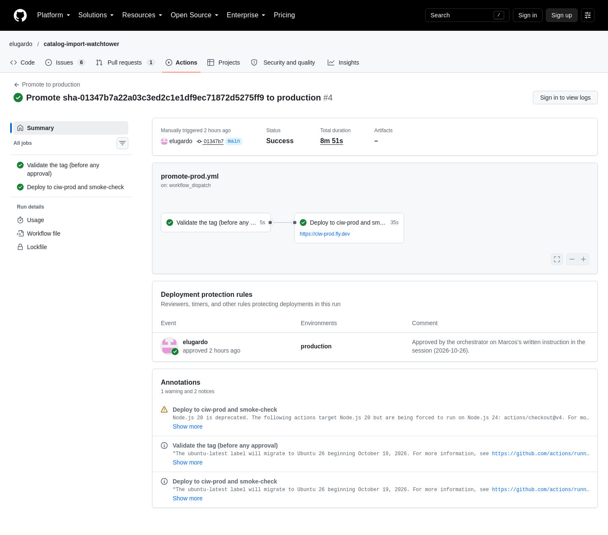
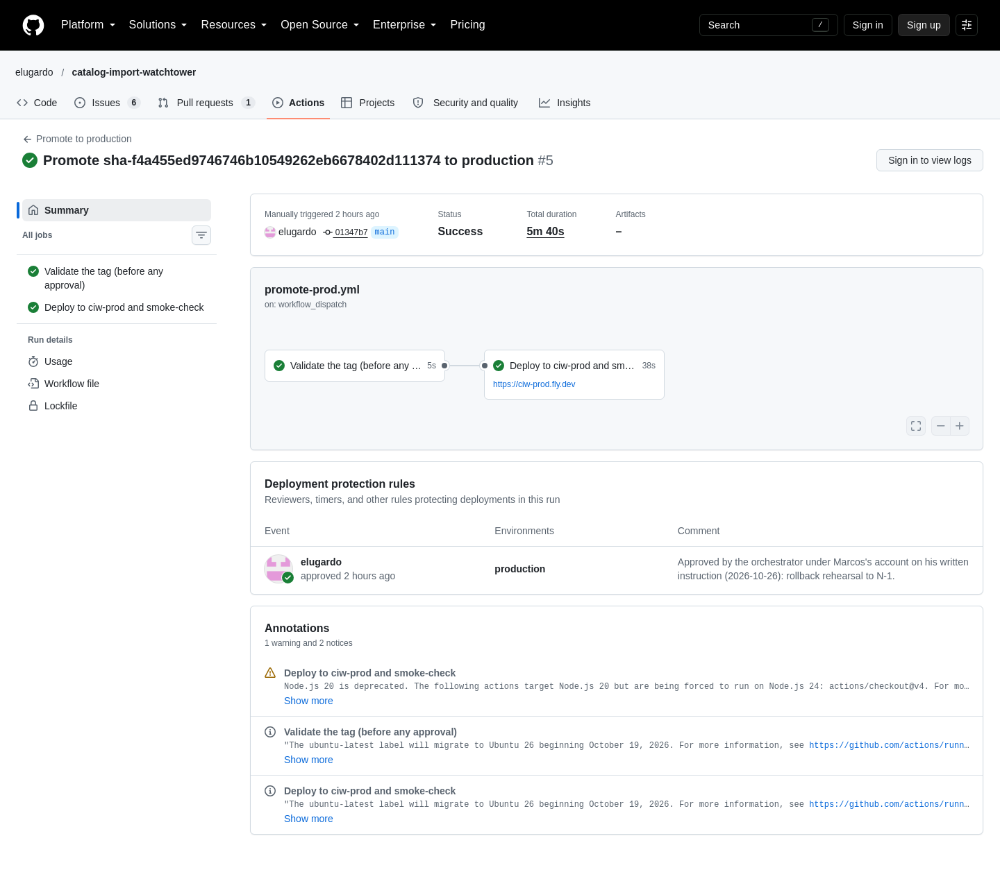
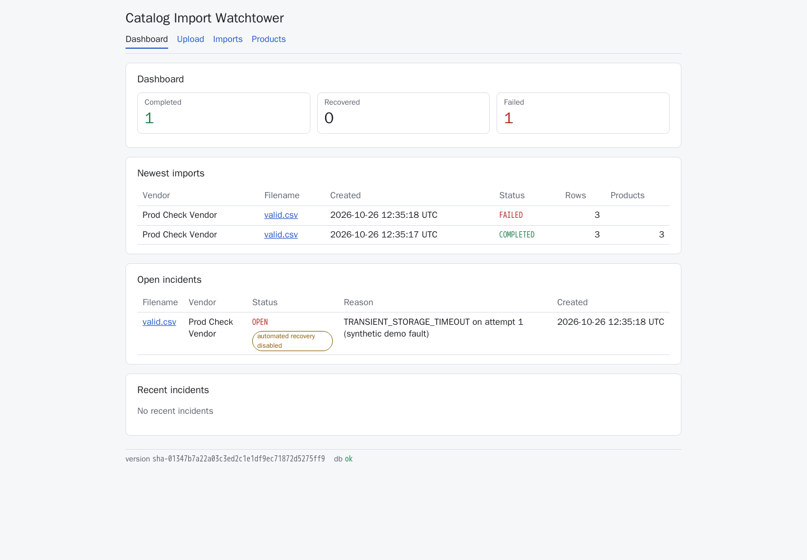
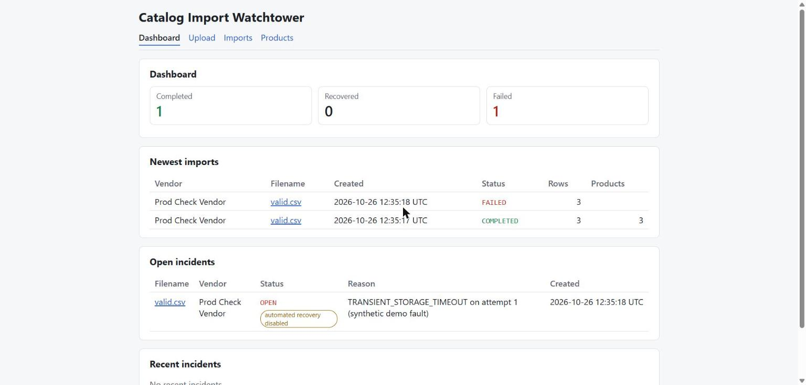
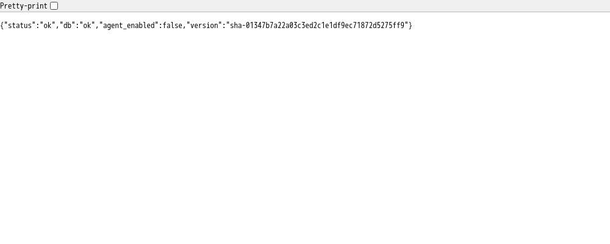
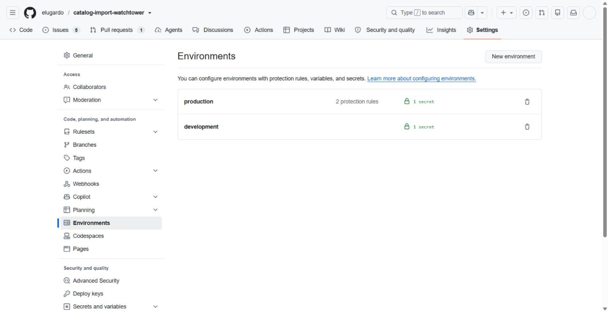
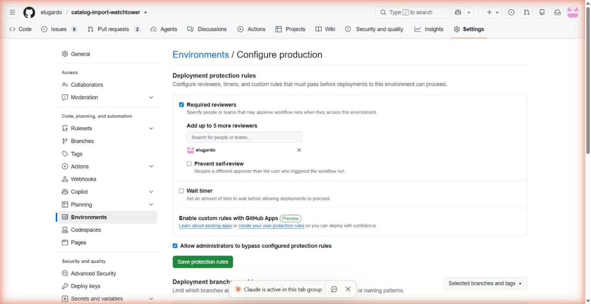
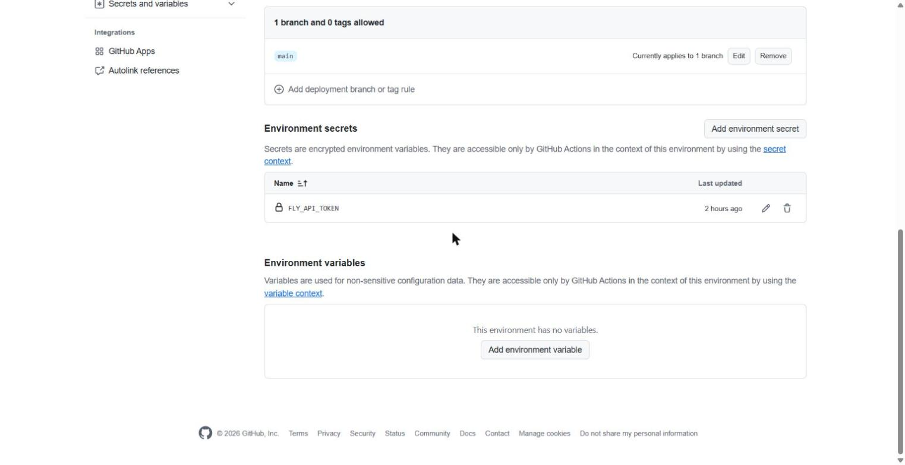
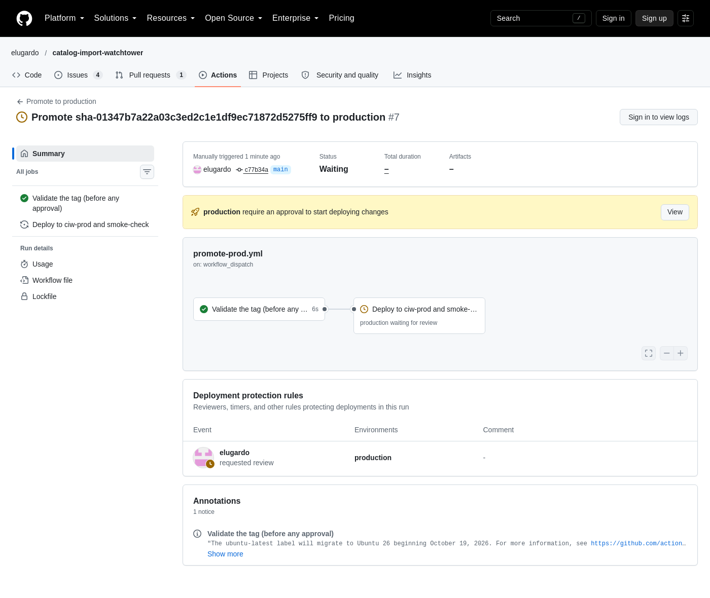
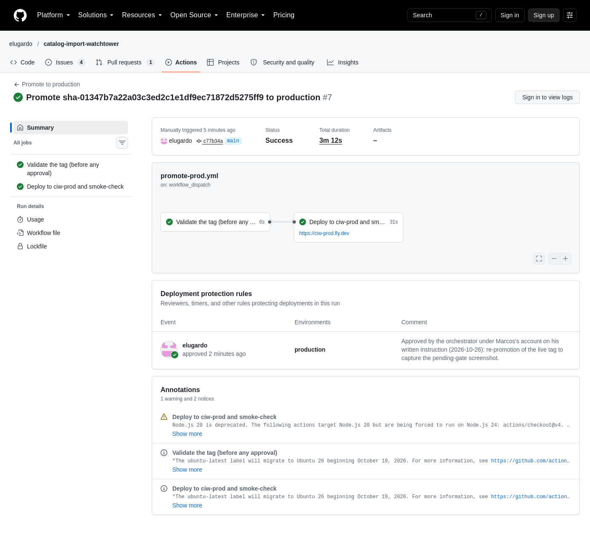

# Deploy to production: evidence for CIW-10.2 (#15)

The post-merge evidence for issue #15, stage 2 of the two-stage close. It covers rubric rows **8**
(Deployment: prod URL and health check) and **9** (CI/CD: manual promotion to prod and the rollback path).
Recorded on 2026-10-26, against `main` at `01347b7a22a03c3ed2c1e1df9ec71872d5275ff9`.

- **Prod URL:** <https://ciw-prod.fly.dev> (Fly app `ciw-prod`, its own Neon project with database `ciw`)
- **Final version on prod:** `sha-01347b7a22a03c3ed2c1e1df9ec71872d5275ff9` (N)
- **Workflow:** `.github/workflows/promote-prod.yml` (`workflow_dispatch`, one `tag` input)

Every production change in this report went through `promote-prod.yml`. Apart from the one-time provisioning the orchestrator did on Marcos's approval (see the checklist), no agent ran `flyctl deploy`,
`flyctl secrets set` or `tokens create`, and neither the engineer nor QA handled a secret value. The `flyctl` calls below were read-only (`status`,
`secrets list`, `machines list`, `releases`). No secret value appears in this report, and neither does the
digest column of `flyctl secrets list`.

## The two tags

Dev deployed both tags successfully with `deploy-dev.yml`:

| Tag | Commit | Dev run |
|---|---|---|
| N-1 = `sha-f4a455ed9746746b10549262eb6678402d111374` | merge of #56 | [40276218575](https://github.com/elugardo/catalog-import-watchtower/actions/runs/40276218575) |
| N = `sha-01347b7a22a03c3ed2c1e1df9ec71872d5275ff9` | merge of #58 | [40320919888](https://github.com/elugardo/catalog-import-watchtower/actions/runs/40320919888) |

**Same Alembic head: `92944f5dfe47`.** `git ls-tree --name-only <sha> alembic/versions/` lists the same
single revision file, `20261025_92944f5dfe47_create_the_six_tables.py`, at both commits.
`git diff --stat f4a455e 01347b7 -- alembic/` is empty. So by the *Rollback* rule in `_docs/operations.md`
(a rollback is supported only between releases with the same Alembic head), N to N-1 is a supported
rollback, and the older image's `alembic upgrade head` is a no-op.

## Refusal runs (fail in `validate`, no approval requested)

Each run failed in the job *Validate the tag (before any approval)*. The job *Deploy to ciw-prod and
smoke-check* was **skipped**, so the `production` environment was never requested. For the third run,
`GET .../actions/runs/40321357399/pending_deployments` returned an empty list.

| Case | Input | Run | Failing step and message |
|---|---|---|---|
| (a) malformed | `dev` | [40321348121](https://github.com/elugardo/catalog-import-watchtower/actions/runs/40321348121) | step (a): `Refused: tag dev is not sha- followed by the full 40-character lowercase hex commit SHA. ...` |
| (b) not in GHCR | `sha-` + 40 zeros | [40321353027](https://github.com/elugardo/catalog-import-watchtower/actions/runs/40321353027) | step (b): `Refused: ghcr.io/elugardo/catalog-import-watchtower:sha-0000...0000 does not exist in GHCR ...` |
| (c) published, never deployed by dev | `sha-d8b90eead3055e5a7588c151c42d18022b9d42b0` | [40321357399](https://github.com/elugardo/catalog-import-watchtower/actions/runs/40321357399) | step (c): `Refused: dev never ran sha-d8b90ee... (no successful deploy-dev.yml run for commit d8b90ee...)` |

For case (c), the tag does exist in GHCR (anonymous `docker manifest inspect` exit 0). `deploy-dev.yml`
runs for that commit with `status=success` have `total_count` 0. Its only run, 40269500510, failed
before provisioning (see `_docs/evidence/2026-10-26-deploy-dev/report.md`).

## Promotion and rollback rehearsal (N, N-1, N)

| Step | Tag | Run | Approval | Deploy job | Smoke check log | `/api/health` `version` afterwards |
|---|---|---|---|---|---|---|
| 1. promote N | `sha-01347b7...5ff9` | [40321537500](https://github.com/elugardo/catalog-import-watchtower/actions/runs/40321537500) | approved, `production` | 12:26:49 to 12:27:24 UTC, green | `[1/30] ... HTTP 200 ... "version":"sha-01347b7a22a03c3ed2c1e1df9ec71872d5275ff9"`, `smoke check passed` | `sha-01347b7a22a03c3ed2c1e1df9ec71872d5275ff9` |
| 2. roll back to N-1 | `sha-f4a455e...1374` | [40323819935](https://github.com/elugardo/catalog-import-watchtower/actions/runs/40323819935) | approved, `production` | 12:41:22 to 12:42:00 UTC, green | `[1/30] ... HTTP 200 ... "version":"sha-f4a455ed9746746b10549262eb6678402d111374"`, `smoke check passed` | `sha-f4a455ed9746746b10549262eb6678402d111374` |
| 3. forward to N | `sha-01347b7...5ff9` | [40324903367](https://github.com/elugardo/catalog-import-watchtower/actions/runs/40324903367) | approved, `production` | 12:46:53 to 12:47:36 UTC, green | `[1/30] ... HTTP 200 ... "version":"sha-01347b7a22a03c3ed2c1e1df9ec71872d5275ff9"`, `smoke check passed` | `sha-01347b7a22a03c3ed2c1e1df9ec71872d5275ff9` |

- Each deploy log prints the image that was running before the deploy, which is the rollback target.
  Run 1 printed none (first deploy), run 2 printed N's image, and run 3 printed N-1's image.
- After each run, the *Keep zero worker machines on ciw-prod* step listed only `app` machines.
- `flyctl releases -a ciw-prod --image` showed v1 = N, v2 = N-1, v3 = N, all `complete`, at rehearsal time; v4 = N again (same image) is the pending-gate re-promotion in section 6.
- **Data survives the rollback.** The two imports below were made on N, before step 2. After step 2
  (on N-1) and after step 3 (on N again), `GET /api/imports` still returned `total` 2: import 1
  `COMPLETED` and import 2 `FAILED`. A rollback does not touch the database.

**Approvals.** The three production approvals were given by the orchestrator through the GitHub
pending-deployments API under Marcos's account, on his written instruction in the session at shortly
before 12:20 UTC (first approval); the environment's required-reviewer gate itself was active and held
each run until approved. Marcos confirmed the instruction again in writing before the second approval.
Each approval's time and comment are recorded in the review history of runs
[40321537500](https://github.com/elugardo/catalog-import-watchtower/actions/runs/40321537500),
[40323819935](https://github.com/elugardo/catalog-import-watchtower/actions/runs/40323819935) and
[40324903367](https://github.com/elugardo/catalog-import-watchtower/actions/runs/40324903367).
`GET .../actions/runs/<id>/approvals` returns `state: approved` for environment `production` on all three.
Each run showed status `waiting` at the gate until it was approved. A fourth promotion of the same
live tag, made later only to screenshot that waiting state, is screenshot 6 below.

## Production checks

| Check | Result |
|---|---|
| `production` environment | required reviewer `elugardo`; environment secrets: `FLY_API_TOKEN` only (names from the API) |
| `flyctl secrets list -a ciw-prod` (names only) | `DATABASE_URL` only (`Staged` before the first deploy, `Deployed` after) |
| `flyctl machines list -a ciw-prod` | one machine, group `app`, image `...:sha-01347b7a22a03c3ed2c1e1df9ec71872d5275ff9`; no `worker` machine |
| `/api/health` | `{"status":"ok","db":"ok","agent_enabled":false,"version":"sha-01347b7a22a03c3ed2c1e1df9ec71872d5275ff9"}` |
| History empty on first promotion | `GET /api/imports` right after step 1: `total` 0 |
| `fixtures/valid.csv` import via the prod API | `POST /api/imports` (vendor `<demo vendor>`): import 1 `COMPLETED`, 1 attempt; `GET /api/products` `total` 3 |
| Injected (synthetic) failure | the same file with `inject_transient_failure=true`: import 2 `FAILED`, `TRANSIENT_STORAGE_TIMEOUT`, alert 1 `OPEN`, reason `TRANSIENT_STORAGE_TIMEOUT on attempt 1 (synthetic demo fault)`; no attempt 2, because the agent is off on prod |
| Prod SPA | <https://ciw-prod.fly.dev/> loads in Chrome. The dashboard shows Completed 1, Recovered 0, Failed 1, both imports, and under *Open incidents* the alert as `OPEN` with **automated recovery disabled** (read from the rendered page in Chrome). The served bundle `/assets/index-fbcjbP7B.js` contains the label |

## `ciw-prod` provisioning checklist

Done once, before the first promotion, by the orchestrator in the session after Marcos approved the
provisioning there. Values are redacted; only names appear.

- [x] Fly app `ciw-prod` created (`flyctl apps create`) with the logged-in `flyctl`.
- [x] New Neon project `ciw-prod` (id `wild-glitter-64640362`), separate from dev, with database `ciw`
      and role `ciw`.
- [x] The project's **direct** (non-pooler) connection URL, rewritten to the
      `postgresql+psycopg://…?sslmode=require` form, staged as the Fly secret `DATABASE_URL` on
      `ciw-prod` only (value never printed; `Staged` before the first deploy, `Deployed` after).
- [x] GitHub environment `production` created with required reviewer `elugardo` and deployment
      branch `main` (screenshots 5a to 5c).
- [x] An app-scoped Fly deploy token for `ciw-prod` stored in the `production` environment as
      `FLY_API_TOKEN` (value never printed). A first token had been stored with a PowerShell BOM and failed
      with `token validation error` on dev; it was replaced, and the BOM-tainted tokens were revoked for
      both apps.
- [x] No `worker` process and no LLM key on prod: `flyctl secrets list -a ciw-prod` holds `DATABASE_URL`
      only.

`flyctl secrets list -a ciw-prod`, names and status only (digest column left out), on 2026-10-26:

```
NAME          STATUS
DATABASE_URL  Deployed
```

## Screenshots

The GitHub settings pages were taken in Marcos's signed-in Chrome with the Claude in Chrome extension.
The public pages (the run pages, the prod SPA and `/api/health`) were taken with headless Chromium
(`mcr.microsoft.com/playwright:v1.48.0-jammy`, anonymous, so the run pages show *Sign in to view logs*).
Every image was checked before commit: it shows secret names only, never a value.

**1. Promotion of N, approved through the `production` gate and green (run 40321537500).** The
*Deployment protection rules* panel is the run's review history: `elugardo` approved, environment
`production`, with the orchestrator's comment. The total duration (8m 51s) against job times of
5s + 35s is the time the run waited at the gate.



**2. Rollback rehearsal: N-1 (run 40323819935) and forward to N (run 40324903367),** each approved for
`production` and green.




**3. Prod SPA dashboard, <https://ciw-prod.fly.dev>.** Completed 1, Recovered 0, Failed 1; the
injected (synthetic) failure is under *Open incidents* as `OPEN` with the **automated recovery
disabled** badge; footer `version sha-01347b7…5ff9`, `db ok`.



The same page in Marcos's Chrome (Claude in Chrome extension):



**4. `https://ciw-prod.fly.dev/api/health`.**



**5. The `production` environment settings.** (a) the environment list (2 protection rules, 1
secret); (b) required reviewer `elugardo`; (c) deployment branch `main` and the one environment secret,
`FLY_API_TOKEN`, name only.







Observation: screenshot 5b also shows *Allow administrators to bypass configured protection rules*
ticked (GitHub's default). The gate held all three runs, and the approvals API shows a review for each,
not a bypass.

**6. A promotion while it waits at the `production` gate (run
[40344257232](https://github.com/elugardo/catalog-import-watchtower/actions/runs/40344257232)).**
The three runs above were screenshotted only after approval, so QA asked for the waiting state itself.
This fourth promotion re-promoted the tag that was already live, `sha-01347b7a22a03c3ed2c1e1df9ec71872d5275ff9`
(N), only to capture that state; prod's version did not change. It was dispatched at 14:55:42 UTC.

(a) While waiting: *Validate the tag (before any approval)* is green, *Deploy to ciw-prod and
smoke-check* shows *production waiting for review*, the run status is **Waiting**, and the banner reads
*production require an approval to start deploying changes*. At that moment
`GET .../actions/runs/40344257232/pending_deployments` returned the one environment `production`.



(b) The same run after approval: **Success** in 3m 12s (validate 6s, deploy 31s; the rest is the time
at the gate). The review history shows `elugardo` approved `production` with the comment *Approved by
the orchestrator under Marcos's account on his written instruction (2026-10-26): re-promotion of the
live tag to capture the pending-gate screenshot.*



The approval was given by the orchestrator through the GitHub pending-deployments API under Marcos's
account, on his written instruction; the engineer who took the screenshots did not approve it.
Afterwards `https://ciw-prod.fly.dev/api/health` still returned
`{"status":"ok","db":"ok","agent_enabled":false,"version":"sha-01347b7a22a03c3ed2c1e1df9ec71872d5275ff9"}`.

## Docs changed with this evidence

- `_docs/operations.md` -> *Rollback*: the **Migrations.** paragraph is replaced with the PM's
  corrected wording from the stage-1 approval (same Alembic head only; fix forward past a migration),
  and the evidence link now points at this report.
- `fly.prod.toml`: the `[deploy]` comment above `release_command` is replaced with the PM's wording.
  No setting changed.
- `_docs/rubric.md` rows 8 and 9 point at this report.